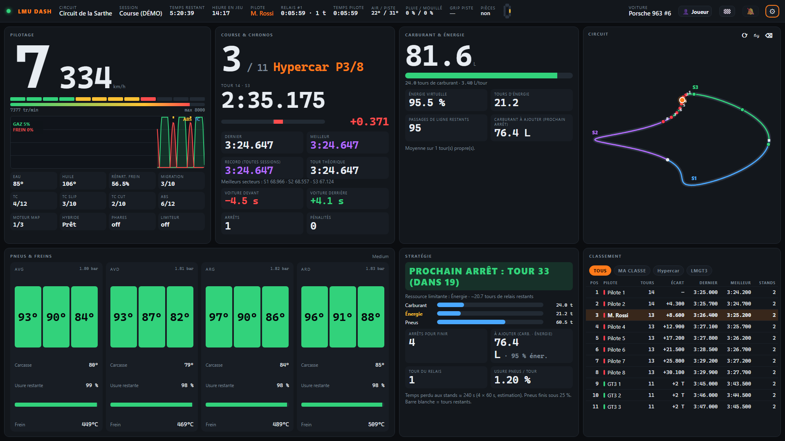
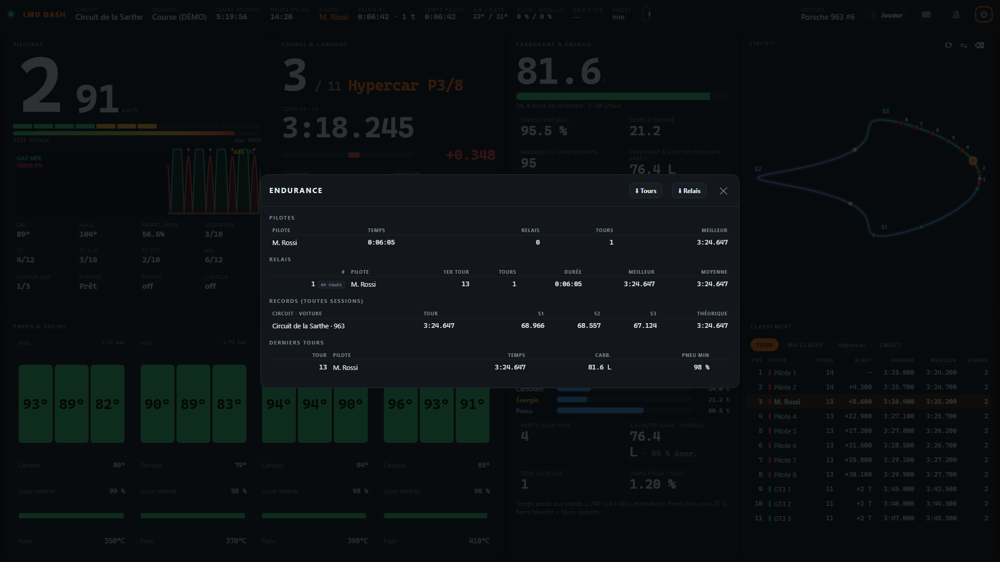

# LMU Dash

**Dashboard second écran pour Le Mans Ultimate** — stratégie, endurance, drapeaux et carte du circuit en direct,
dans ton navigateur.

## Installation (Windows)

1. Télécharge **[LMU-Dash.exe](https://github.com/N4ole/LMU-dash/releases/latest/download/LMU-Dash.exe)** (aucun prérequis).
2. Dans LMU : *Settings → Gameplay →* **Enable Plugins**.
3. Lance `LMU-Dash.exe` : le navigateur s'ouvre sur <http://localhost:8765>. Glisse la page sur ton 2ᵉ écran, **F11**.

Pas encore de jeu lancé ? `LMU-Dash.exe --demo` affiche une course simulée.

Autres façons de l'installer

- **Avec Python 3.10+** (aucune dépendance) : `python server.py`, ou double-clic sur `lancer.bat`
  (`lancer_demo.bat` pour la démo).
- **Construire l'exe toi-même** : `build_exe.bat` → `dist\LMU-Dash.exe`.
- **Vérifier l'exe téléchargé** : chaque release donne son SHA256 et une attestation de provenance signée par
  GitHub Actions : `gh attestation verify LMU-Dash.exe --repo N4ole/LMU-dash`.

## Fonctions

| | |
|---|---|
| 🏎️ **Pilotage** | vitesse, rapport, régime, courbes gaz/frein, températures eau/huile, aides (TC, ABS, cartographie moteur, hybride) |
| ⏱️ **Course & chronos** | position (générale et par classe), tour en cours et delta, dernier/meilleur tour, meilleurs secteurs, écarts devant/derrière, pénalités |
| ⛽ **Carburant & énergie** | niveau, conso par tour, énergie virtuelle, tours restants, quantité à ajouter au prochain arrêt |
| 🧠 **Stratégie** | ressource limitante (carburant / énergie / pneus), prochain arrêt, arrêts pour finir, économie suggérée pour en éviter un ; tours sous SC/FCY exclus, **temps perdu aux stands mesuré** |
| 🛞 **Pneus & freins** | températures intérieur/milieu/extérieur, carcasse, pression, usure ; seuil « pneu fini » par gomme |
| 🗺️ **Carte du circuit** | tracé appris automatiquement, toutes les voitures, secteurs S1/S2/S3, jaunes clignotants, voiture arrêtée entourée |
| 🚩 **Drapeaux** | FCY / Safety car (stands ouverts/fermés), jaune **dans ton secteur / le prochain**, voiture à l'arrêt devant (distance), bleu, rouge |
| 🔔 **Alertes** | bandeau, halo et bips : carburant, surchauffe, pneus, BOX, drapeaux, dégâts, pluie, limites de relais — chacune désactivable |
| 🏁 **Endurance** | pilote actuel, relais, temps cumulé par pilote avec limite, historique des tours, export CSV |
| 🏆 **Records** | meilleur tour et secteurs par circuit + voiture, toutes sessions, tour théorique |
| 👤 **Profils** | un dossier par joueur (réglages, records, archives), changement en un clic |
| 🤝 **Cartes partagées** | les circuits déjà cartographiés par la communauté sont téléchargés au démarrage |
| 📱 **Tablette / 2ᵉ PC** | `--host 0.0.0.0`, puis `http://IP_DU_PC:8765` sur le réseau local |

## Options de lancement

| Option | Effet |
|---|---|
| `--demo` / `--demo-speed 25` | course simulée, éventuellement accélérée |
| `--host 0.0.0.0` | accessible depuis le réseau local (sans mot de passe : réseau de confiance uniquement) |
| `--port 8765` | port HTTP |
| `--profile Nom` | démarre sur ce profil (créé s'il n'existe pas) |
| `--data-dir DOSSIER` | où sauvegarder les données |
| `--pit-loss 60` | temps perdu par arrêt (s) tant qu'aucun n'a été mesuré |
| `--no-sync` | hors-ligne : ni cartes partagées, ni recherche de nouvelle version |
| `--no-browser` | n'ouvre pas le navigateur |
| `--version` | affiche la version |

## FAQ

<b>Windows Defender / mon antivirus bloque LMU-Dash.exe</b>

C'est un faux positif fréquent avec les exécutables PyInstaller non signés. Télécharge l'exe uniquement depuis
les [Releases](https://github.com/N4ole/LMU-dash/releases), vérifie son SHA256 ou son attestation
(`gh attestation verify`), ou lance directement la version Python (`python server.py`), qui est identique.

<b>Le dashboard affiche « en attente » alors que je roule</b>

Active *Enable Plugins* dans LMU (*Settings → Gameplay*), puis redémarre le jeu. LMU Dash lit la mémoire partagée
officielle du jeu : il doit tourner sur le même PC que LMU.

<b>La carte du circuit est vide ou incomplète</b>

Elle s'apprend en roulant (avec la position de toutes les voitures) : un tour suffit en général. Si le circuit a
déjà été partagé par la communauté, il est téléchargé automatiquement au démarrage. ⟳ pivote la carte,
⇋ la retourne, ⌫ la réapprend.

<b>Où sont mes données ? Comment les sauvegarder ?</b>

Dans le dossier `data/` à côté du programme (ou `%APPDATA%\LMU-Dash` s'il n'est pas inscriptible) : réglages,
profils, cartes, records, état de course (repris automatiquement après un plantage de moins de 30 min) et
archives CSV de chaque session. Copie ce dossier pour tout sauvegarder.

<b>LMU Dash envoie-t-il des données sur Internet ?</b>

Non. Il **télécharge** seulement, depuis ce dépôt public, les cartes de circuits partagées et le numéro de la
dernière version (API GitHub, une fois par jour). Rien n'est envoyé ; `--no-sync` coupe tout accès réseau.

<b>Comment partager une carte que j'ai apprise ?</b>

Quand une carte est complète, ⚙ s'entoure d'orange : « Exporter la carte actuelle », puis dépose le fichier
sur GitHub en Pull Request. Tout est expliqué dans [CONTRIBUTING.md](CONTRIBUTING.md#️-partager-une-carte-de-circuit).

<b>Est-ce que ça marche sur Linux ou macOS ?</b>

Le mode démo et le développement, oui. La lecture du jeu utilise la mémoire partagée Windows de LMU : il faut
lancer LMU Dash sur le PC Windows du jeu. Les autres appareils (tablette, Mac...) peuvent afficher le dashboard
via `--host 0.0.0.0`.

## Fonctionnement en détail

- **Stratégie** — Les tours sous Safety Car / FCY ne comptent ni dans la conso ni dans l'usure. Le temps perdu aux
  stands est mesuré (tour d'entrée + tour de sortie − 2 tours de référence, moyenne des 3 derniers arrêts) ; avant
  le premier arrêt, la valeur des réglages est utilisée. En course au temps, on finit au premier passage de ligne
  après la fin du chrono (le tour supplémentaire est pris en compte).
- **Drapeaux** — Une seule logique côté serveur (`flags.py`) alimente la bannière, la carte et les alertes. Le jeu
  ne précise pas si `mSectorFlag[0]` est S1 ou S3 : LMU Dash l'apprend en croisant jaunes locaux et voitures
  arrêtées (mémorisé dans `settings.json`, clé `flagMap`).
- **Records** — Seuls les tours propres comptent (pas de stand, pas neutralisé, pas invalidé).
- **Cartes partagées** — Au démarrage puis toutes les 6 h, l'app lit `tracks/index.json` de ce dépôt
  (`--shared-repo owner/nom` pour un autre) et télécharge les circuits qui lui manquent ; chaque fichier est
  validé avant usage.

## Contribuer

Cartes de circuits, corrections, idées : tout est le bienvenu ! Lis [CONTRIBUTING.md](CONTRIBUTING.md), pose tes
questions dans les [Discussions](https://github.com/N4ole/LMU-dash/discussions) et signale les bugs dans les
[issues](https://github.com/N4ole/LMU-dash/issues/new/choose). Failles de sécurité : voir [SECURITY.md](SECURITY.md).

Historique des versions : [CHANGELOG.md](CHANGELOG.md).

## Licence

[MIT](LICENSE). La lecture de la mémoire partagée s'appuie sur pyLMUSharedMemory (MIT, dossier
`pyLMUSharedMemory/`). Projet communautaire non officiel, sans lien avec les éditeurs de Le Mans Ultimate.
